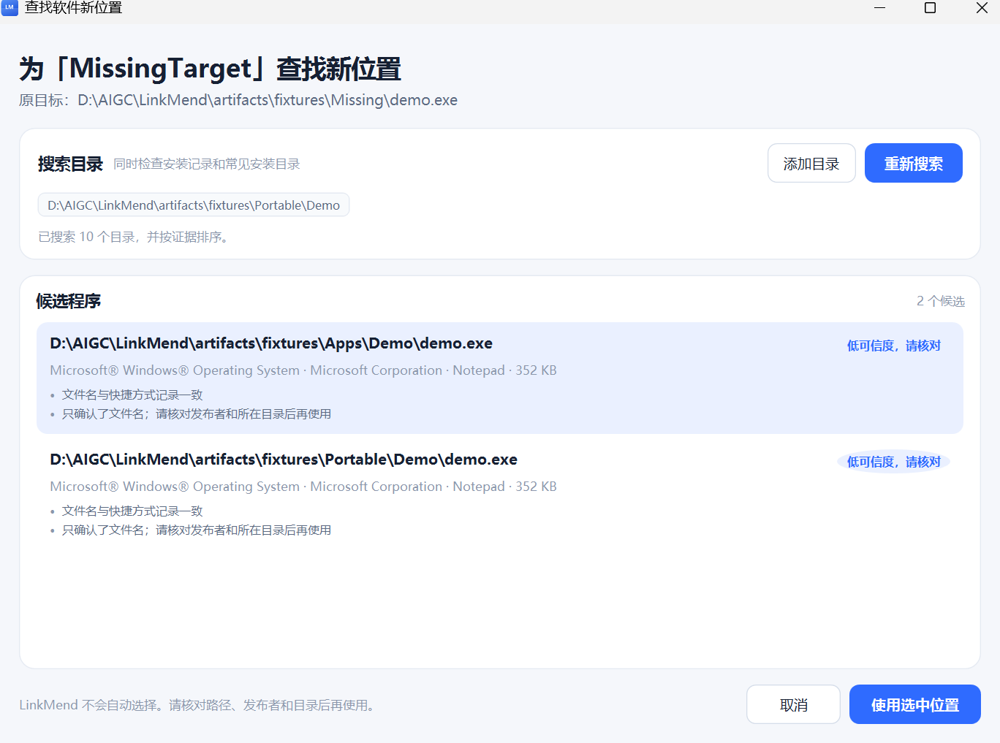
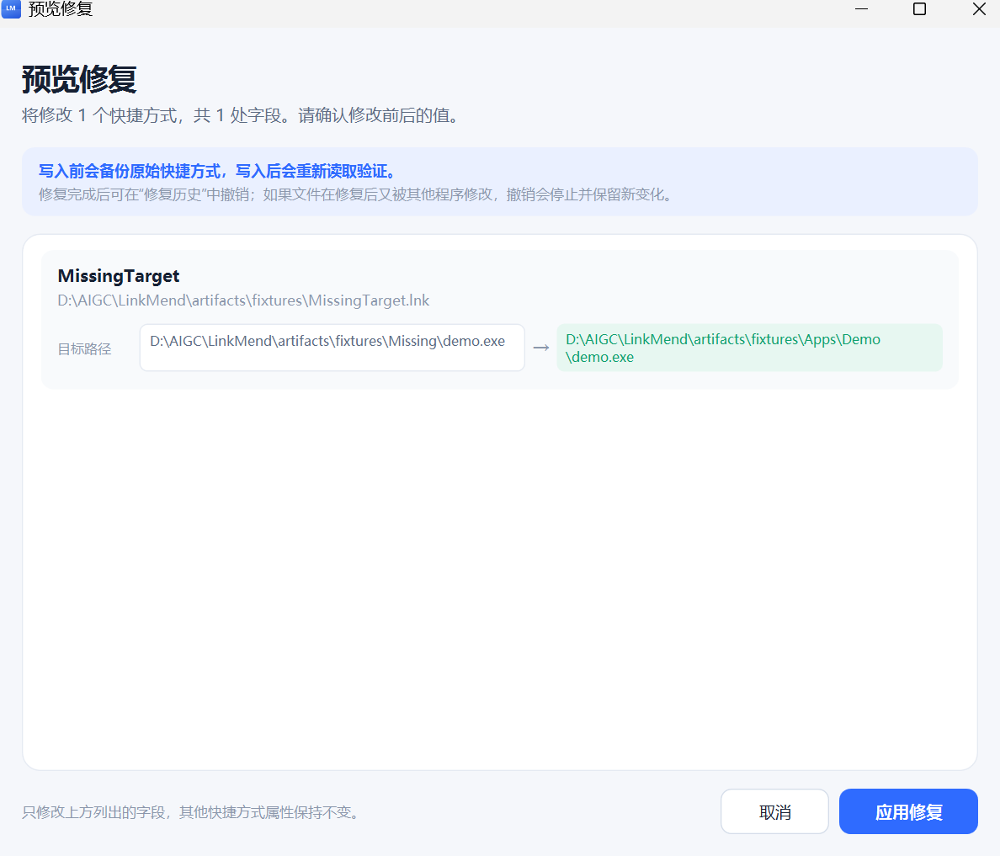
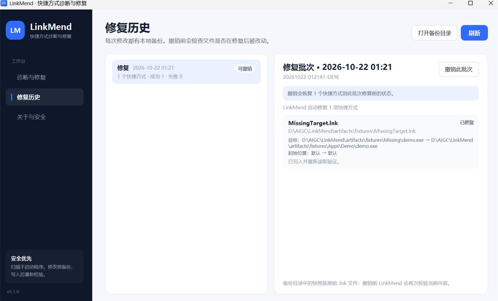

# LinkMend

**Windows 快捷方式诊断与修复工具 / Windows shortcut diagnostics and repair.**

中文优先、本地运行、先解释原因再修改，写入前备份，支持预览与安全撤销。

Chinese-first and local-first. Explain before changing, back up before writing, and support preview and safe undo.


[下载 Windows 安装版](https://github.com/qinmuran0316/LinkMend/releases/download/v0.1.2/LinkMend-v0.1.2-win-x64-Setup.exe) · [下载免安装版](https://github.com/qinmuran0316/LinkMend/releases/download/v0.1.2/LinkMend-v0.1.2-win-x64.zip) · [全部版本 / Releases](https://github.com/qinmuran0316/LinkMend/releases)

[简体中文](#简体中文) · [English](#english)

---

## 简体中文

LinkMend 面向常见的“快捷方式坏了”场景：目标程序被移动或卸载、图标变白、起始位置失效、磁盘暂时离线、同名程序难以辨认，以及多个快捷方式使用了不同的数据目录。它不会把所有读取失败都粗暴地判成“快捷方式失效”，也不会在证据不足时自动改文件。

> 界面截图来自项目自带的隔离测试快捷方式，不包含真实用户数据。


### 核心能力

| 能力 | 具体行为 |
| --- | --- |
| 扫描 | 默认桌面与开始菜单，支持自定义文件夹、拖入 `.lnk`，显示进度并可取消 |
| 目标诊断 | 区分目标不存在、磁盘未就绪、网络离线、权限不足、路径无效和未知读取错误 |
| 白图标诊断 | 检查自定义图标源是否存在、索引是否可取；只对可验证的图标问题提供修复 |
| 起始位置 | 目标仍存在时，将无效起始位置改到程序目录；磁盘离线等情况下不擅自修改 |
| 搬家定位 | 结合 App Paths、卸载记录和有限目录扫描，给出候选程序与证据；支持自动采用高置信度且明显领先的唯一候选 |
| 自动修复 | 一键搜索目标丢失的快捷方式，自动加入安全候选并进入统一修复预览；歧义结果保留给用户确认 |
| 中英文界面 | 在“关于与安全”页切换简体中文 / English，设置会保存到本机 |
| 数据目录检查 | 分析显式启动参数，报告不可用目录和同目标快捷方式之间的配置冲突，不自动改参数 |
| 修复预览 | 逐字段展示目标、起始位置、图标的修改前后值 |
| 安全修复 | 修复前备份原始 `.lnk`，写入后重新读取验证；验证失败且文件仍为本次写入的内容时自动恢复 |
| 撤销 | 按批次撤销；撤销前检查文件是否在修复后又被修改，发现变化则停止 |
| 审计 | 修复与撤销历史保存在本地，包含快照、校验值和每项结果 |

#### 定位候选



#### 修改预览



#### 备份与撤销



### 安全模型

LinkMend 把“准确判断”和“安全写入”拆成独立步骤：

1. **扫描不启动目标程序。** 只读取 `.lnk` 字段并用文件系统元数据验证路径；不执行链接目标。
2. **不把未知当成损坏。** 磁盘/网络不可用、权限不足、解析失败会分别报告，不会触发“改为另一个程序”的建议。
3. **只自动采用强证据候选。** 同名程序可能有多个；自动流程只接受高置信度且分数明显领先的候选，接近或证据不足的结果仍要求用户确认。
4. **修改前先备份。** 原始 `.lnk` 字节和 SHA-256 写入本地批次目录；历史记录同时保存修改前后的字段。
5. **扫描后若文件变化，拒绝覆盖。** 修复前会重新计算当前哈希；与扫描时不一致就跳过。
6. **写入后重新读取验证。** 目标、起始位置、图标不符合预期时，仅在文件仍匹配本次写入的内容时用快照恢复；其他程序的新修改或删除会被保留。
7. **撤销前整批检查。** 比对所有待撤销文件与修复后的哈希，并校验原始快照；预检发现冲突则整批停止。执行中遇到新的冲突或 I/O 失败可能部分完成，剩余项目可重试。
8. **不主动提权。** 应用以当前用户权限运行；权限不足会如实提示，需要时由用户自行决定是否以管理员身份运行。

### 快速开始

#### 运行环境

- Windows 10 1809+ 或 Windows 11，x64
- 运行时采用自包含发布时，用户不需要预装 .NET；从源码构建需要 **.NET 10 SDK**

#### 下载并安装（推荐）

1. 打开 [Releases 发布页](https://github.com/qinmuran0316/LinkMend/releases/latest)。
2. 展开 **Assets**，下载 **`LinkMend-v0.1.2-win-x64-Setup.exe`**，也可[直接下载安装包](https://github.com/qinmuran0316/LinkMend/releases/download/v0.1.2/LinkMend-v0.1.2-win-x64-Setup.exe)。公开发布包无需登录 GitHub 即可下载。
3. 双击下载的安装程序。
4. 按安装向导选择目录、开始菜单文件夹，以及是否创建桌面快捷方式；完成后启动 **LinkMend**。

安装包支持简体中文和英文向导，默认安装到当前用户的 `%LOCALAPPDATA%\Programs\LinkMend`，无需管理员权限，也不需要预装 .NET。可从开始菜单或桌面快捷方式启动。

需要免安装版时，下载 [**`LinkMend-v0.1.2-win-x64.zip`**](https://github.com/qinmuran0316/LinkMend/releases/download/v0.1.2/LinkMend-v0.1.2-win-x64.zip)，解压后运行其中的 **`LinkMend.exe`**。`Source code` 是源码，直接运行请使用上述安装 EXE 或免安装 ZIP。

开发构建仍可在 [Actions → ci](https://github.com/qinmuran0316/LinkMend/actions/workflows/ci.yml) 的成功运行中下载 **Artifacts → LinkMend-win-x64**，其中包含安装 EXE、免安装 ZIP 及校验文件；这种下载方式需要登录 GitHub。正式版本请优先使用 Releases。

安装版更新时先关闭 LinkMend，再运行新版 `Setup.exe`，沿用原安装目录。卸载可在 **Windows 设置 → 应用** 中选择 **LinkMend**，或使用开始菜单中的卸载入口。程序运行期间，安装程序会阻止升级和卸载，避免中断文件写入。

备份、历史和设置位于 `%LOCALAPPDATA%\LinkMend`，升级与卸载会保留这些数据；重装后可继续查看历史。免安装版更新时关闭旧程序，再解压并运行新包即可。

#### 从源码构建

```powershell
git clone https://github.com/qinmuran0316/LinkMend.git
cd LinkMend
dotnet restore LinkMend.slnx
dotnet build LinkMend.slnx -c Release
dotnet test tests/LinkMend.Tests/LinkMend.Tests.csproj -c Release
dotnet run --project src/LinkMend.App/LinkMend.App.csproj -c Debug
```

#### 生成安装包

```powershell
powershell -NoProfile -ExecutionPolicy Bypass -File scripts/build-installer.ps1
```

脚本先发布 x64 自包含应用，再生成安装程序与免安装 ZIP：

```text
artifacts/release/LinkMend-v0.1.2-win-x64-Setup.exe
artifacts/release/LinkMend-v0.1.2-win-x64.zip
```

两种文件均附带 `.sha256` 校验文件。首次构建会下载固定版本的官方 Inno Setup 6.7.3 编译器及简体中文语言文件并校验 SHA-256；编译器以便携模式放在 `artifacts/tools/`，不注册到系统安装列表。已发布应用时可添加 `-SkipPublish` 只重新制作安装包。

#### 只生成免安装发布包

```powershell
powershell -ExecutionPolicy Bypass -File scripts/publish.ps1
```

输出：

```text
artifacts/release/LinkMend-v0.1.2-win-x64.zip
```

发布包为自包含单文件 WPF 应用，解压后运行 `LinkMend.exe` 即可。GitHub Actions 会构建并验证安装版，然后将安装 EXE、免安装 ZIP 及校验文件上传到 **LinkMend-win-x64**。

### 使用方法

#### 1. 选择范围并检查

打开 **诊断与修复**，勾选 **桌面**、**开始菜单**；其他位置使用 **+ 添加文件夹**。也可以把 `.lnk` 文件或含有快捷方式的文件夹拖入窗口，再点击 **开始检查**。只扫描你选择的范围，不会启动目标程序；扫描期间可以点击 **取消检查**。

检查结束后，点击左侧的问题项，在右侧查看原目标、图标、起始位置及判断依据。磁盘离线、网络不可达或权限不足的项目，应先恢复访问再重新检查。数据目录冲突只提供提示，需要自行核对程序的启动参数。

#### 2. 自动搜索并修复

扫描完成后，如果存在目标丢失或其他可安全修复的项目，点击右上角 **自动搜索并修复**。LinkMend 会自行检查安装记录、原目标目录、快捷方式所在目录和常见安装目录，不要求先选择软件文件夹。高置信度且明显领先的结果会加入修复预览；多个候选接近、只有文件名匹配或完全找不到的项目不会被自动修改，仍可通过 **查找新位置** 手动确认。

#### 3. 修复图标或起始位置

对有可应用建议的项目勾选复选框，再点击 **预览并修复已选**；也可选中单项后点击 **修复此项**。**全选可处理** 用于批量选择，**清空选择** 用于取消勾选。目标丢失的项目需要先完成下一步的新位置确认。

#### 4. 为搬家的程序定位新目标

1. 选中“目标丢失”的项目，点击 **查找新位置**，等待候选列表加载。
2. 核对候选的完整路径、产品名、发布者和匹配理由。若没有找到，点击 **添加目录** 选择软件的新安装目录，等待搜索；需要再查时点击 **重新搜索**。
3. 选中正确的候选，点击 **使用选中位置** 返回主窗口。此时只记录了你的选择，尚未修改快捷方式。
4. 点击 **修复此项** 或 **预览并修复已选** 进入预览。

例如：原目标为 `D:\Apps\Example\Example.exe`，程序已移动到 `E:\Software\Example\Example.exe`。添加 `E:\Software\Example` 搜索，选中该程序并核对预览中的新目标，再应用修复。若程序已卸载且没有候选，请先重新安装程序或手动重建快捷方式。

#### 5. 确认预览并应用

在 **预览修复** 窗口逐项核对“修改前 / 修改后”的目标、起始位置和图标。确认后点击 **应用修复**；点击 **取消** 会放弃本次预览。工具会先备份原始 `.lnk`，再修改并校验结果；结果窗口会列出成功、失败和跳过的项目。存在成功项时会自动重新检查。

若提示“文件发生变化”，请重新检查后再选择修复，避免使用过期的诊断结果。修复和撤销写入期间，关闭窗口会被暂时阻止，请等待结果。

#### 6. 切换界面语言

打开 **关于与安全**，在“语言 / Language”下拉框选择 **简体中文** 或 **English**。切换会立即应用到主窗口和已打开的对话框，并保存到 `%LOCALAPPDATA%\LinkMend\settings.json`。

#### 7. 查看历史与撤销

打开 **修复历史**，选中要恢复的修复批次，查看每项结果后点击 **撤销此批次**，在确认框中确认。使用 **打开备份目录** 可查看原始快照；默认数据目录为 `%LOCALAPPDATA%\LinkMend`。

撤销前若发现文件已修改、已删除或快照损坏，会显示冲突并整批停止；请按提示处理，保留你需要的新内容。执行中发生新的冲突或 I/O 错误时可能只完成一部分：选择显示 **部分撤销** 的原修复批次，查看 **待撤销** 数量，处理失败原因后再次点击 **撤销此批次**，只重试剩余项目。已全部撤销的批次不能重复撤销。

### 诊断规则

#### 目标路径

| 情况 | 判定 | 可做什么 |
| --- | --- | --- |
| 文件或文件夹存在 | 正常 | 无需处理 |
| 目标不存在 | 失效，可定位 | 搜索候选；用户确认后改目标 |
| 磁盘未就绪 / 光驱无介质 | 当前不可用，**不是永久失效** | 恢复磁盘后重新扫描 |
| 网络共享/映射盘离线 | 当前不可用 | 恢复网络后重新扫描 |
| 拒绝访问 | 状态未知 | 检查权限；可尝试以管理员身份重新扫描 |
| 路径格式无效 | 无法解析 | 手动重建或指定 |
| Shell 命名空间 / 特殊托管项 | 不支持 | 保留现状，不自动修改 |

#### 图标

- 自定义图标文件不存在：在目标可用时可改为目标自带图标，或恢复系统默认图标。
- 图标文件存在但记录的索引取不到：可改用目标程序图标或清除失效的自定义图标。
- 目标丢失且未单独指定图标：白图标是目标缺失的表现，先解决目标。
- **目标与图标路径都正常但图标仍为白**：可能是 Windows 图标缓存问题。本版不做强制缓存清理，也不会假装修复。

#### 起始位置

- 目标存在、起始位置不存在：可安全改为目标所在目录。
- 起始位置位于离线磁盘/网络或无权访问：只提示，不自动修改，以免覆盖有意的配置。
- 起始位置为空：使用系统默认行为，不报问题。

#### 数据目录参数

LinkMend 只分析以下**显式启动参数**：

```text
--user-data-dir
--data-dir
--datadir
--user-data-path
```

- 目录所在磁盘/网络离线或无权限访问：警告，不自动改启动参数。
- 同一目标文件的多个快捷方式使用不同的数据目录：提示可能存在配置冲突；也可能是有意隔离。由用户判断。
- 目录暂时不存在不单独判为故障，应用可能自行创建。

这不是应用配置的通用解析器。它只提供可解释的线索，不会猜测某个程序的私有配置文件格式。

### 新位置搜索如何工作

候选来源：

1. Windows **App Paths** 注册表项；
2. 卸载记录中的 `InstallLocation` / `DisplayIcon`；
3. 用户添加的搜索目录；
4. 原目标所在目录、快捷方式所在目录；
5. 各固定磁盘上的常见安装目录（Program Files、Programs、Apps、Software、Tools 等）和当前用户的 `LocalAppData\Programs`。

搜索有深度、目录数、结果数和单目录时间上限；不跟随重解析点。候选按以下证据排序：

- 文件名一致；
- 系统登记来源；
- 所在文件夹与原位置同名；
- 产品名、发布者、文件说明一致（可从原文件读取时）；
- 文件大小接近。

所有同名候选都会明确标出可信度，**不会自动应用**。

### 项目结构

```text
src/
  LinkMend.Core/      领域模型、诊断规则、定位评分、备份/修复/撤销、扫描编排
  LinkMend.Windows/   IShellLink COM 读写、文件/图标/磁盘探测、安装索引、有限目录搜索、STA 执行器
  LinkMend.App/       WPF 中文界面、设置、对话框、视图模型
tests/
  LinkMend.Tests/     单元测试 + ShellLink COM 真实读写测试
docs/
  architecture.md     分层、流程、数据格式与安全不变量
installer/
  LinkMend.iss         当前用户安装、快捷方式、升级与卸载
scripts/
  publish.ps1         自包含发布与 ZIP 打包
  build-installer.ps1  下载校验编译器并生成安装包
  test-installer.ps1   安装、启动、升级与卸载验证
  Create-Icon.ps1     生成应用图标
```

核心服务不依赖 WPF；Windows 专用实现与 UI 分离。ShellLink COM 调用统一在专用 STA 线程上执行，避免在异步续体里跨套间使用 COM。

更多设计细节见 [docs/architecture.md](docs/architecture.md)。

0.1.1 的问题检查、修复与验证记录见 [docs/review-0.1.1.md](docs/review-0.1.1.md)。

### 测试

```powershell
dotnet test tests/LinkMend.Tests/LinkMend.Tests.csproj --nologo
```

当前测试覆盖：

- 中文、空格、环境变量和相对路径；
- 目标丢失、磁盘离线、权限不足、图标源/索引失效、特殊快捷方式；
- 数据目录冲突只标记真正携带该参数的快捷方式；
- 候选排序、去重、取消和文件消失；
- 预览计划生成；
- 修复备份、扫描后变化拒绝、写入校验失败自动回滚；
- 撤销成功、修复后再次变化拒绝撤销、部分撤销重试、重复撤销拒绝；
- 读取期间变化、提交前删除/修改、快照损坏时整批停止；
- 备份路径穿越防护、特殊 Windows 文件名、异常历史结构和带 BOM 的历史文件；
- 通过真实 `IShellLink` / `WScript.Shell` 创建、读取、修改和清除图标。

安装包另有真实流程检查：

```powershell
powershell -NoProfile -ExecutionPolicy Bypass -File scripts/test-installer.ps1
```

请在尚未安装 LinkMend 的测试用户下运行。脚本使用独立测试安装目录，验证中文与空格路径、快捷方式、启动退出、运行中阻止升级/卸载、覆盖安装、卸载清理及数据保留；结束后卸载测试副本。CI 自动执行该检查并上传验证记录。

### 数据位置

默认目录：

```text
%LOCALAPPDATA%\LinkMend\
  Backups\<批次号>\item-001.bak ...
  History\<批次号>.json
  settings.json
  linkmend.log
```

- 备份是原始 `.lnk` 的明文快照。
- 历史记录包含路径、修改前后字段、SHA-256 和结果。
- LinkMend 运行时不发起网络请求，不上传快捷方式或程序信息。

### 已知限制

- 只处理经典 `.lnk`；不处理 `.url`、MSI 公告式快捷方式、Shell 命名空间项和 UWP 专用链接。
- 不清理 Windows 图标缓存，因此“路径都正常但图标仍白”的情况会保留原状。
- 不搜索全盘；搜索范围有限，找不到时请添加软件所在目录。
- 同名程序的元数据可能相同，最终需要用户确认，不能保证语义上一定是同一个程序。
- 撤销前整批校验剩余文件与快照；发现冲突则停止。执行中遇到新的冲突或 I/O 失败可能部分完成，可继续撤销剩余项目。
- 备份未加密，能读取当前用户 `%LOCALAPPDATA%` 的其他进程也可能读取这些快照。
- LinkMend 使用 ShellLink 加载并保存 `.lnk`；不理解的 Shell 扩展字段是否保留取决于系统实现，因此所有写入都有备份。
- 扫描是只读的，但网络路径不可达时单次文件探测可能受系统超时影响。

### 设计参考

以下项目只作为实现思路和界面方向参考，本项目未复制其源代码，也没有引入其为运行时依赖：

- [securifybv/ShellLink](https://github.com/securifybv/ShellLink) — .NET 中 ShellLink 字段处理的思路
- [Matmaus/LnkParse3](https://github.com/Matmaus/LnkParse3) — 异常/损坏 `.lnk` 的解析视角
- [lepoco/wpfui](https://github.com/lepoco/wpfui) — Fluent 风格方向

界面使用原生 WPF 自绘样式，避免额外 UI 依赖并缩小发布包。运行时依赖只有 .NET，测试依赖 xUnit 与 Microsoft.NET.Test.Sdk。

### 许可证

[MIT](LICENSE)

---

## English

LinkMend addresses the common failure modes of Windows shortcuts: a target application moved or uninstalled, a white icon, a broken working directory, a temporarily unavailable disk, ambiguous programs with the same filename, and shortcuts that point the same program at different data directories. It does not treat every read failure as a permanently broken shortcut, and it does not modify files when the evidence is insufficient.

> Screenshots use isolated test shortcuts created by the project. No real user data is included.


The application UI supports Simplified Chinese and English. Choose the language in **About & Safety**; the setting is saved locally.

### Core capabilities

| Capability | Behavior |
| --- | --- |
| Scan | Desktop and Start Menu by default; custom folders and dropped `.lnk` files; progress and cancellation |
| Target diagnosis | Distinguishes a missing target, offline disk, offline network path, access denied, invalid path, and unknown read errors |
| White-icon diagnosis | Checks whether a custom icon source exists and whether its index can be read; only verifiable icon problems get automatic fixes |
| Working directory | Changes an invalid start-in directory to the program folder when the target exists; does not modify it when a disk is offline |
| Relocation | Combines App Paths, uninstall records, and bounded directory searches; strong, clearly leading candidates can be selected automatically |
| Auto repair | Searches missing targets in one click and sends only safe matches to the repair preview; ambiguous matches remain for confirmation |
| Bilingual UI | Switch between Simplified Chinese and English in the app; the choice persists locally |
| Data directory checks | Analyzes explicit command-line switches; reports unavailable directories and conflicts between shortcuts for the same target; never changes arguments automatically |
| Repair preview | Shows before/after values for target, working directory, and icon field by field |
| Safe repair | Backs up the original `.lnk`, reads back and verifies after writing, and restores on failure while the file still matches this operation's write |
| Undo | Undo is grouped by batch; before restoring, it checks whether files changed again after repair and stops on conflict |
| Audit | Repair and undo history is stored locally with snapshots, checksums, and per-item results |

#### Relocation candidates


#### Repair preview


#### Backup and undo


### Safety model

LinkMend separates accurate diagnosis from safe writes:

1. **Scanning never starts the target.** It reads `.lnk` fields and validates paths against filesystem metadata; it never executes the linked target.
2. **Unknown is not broken.** Offline disks or networks, access denied, and parse failures are reported separately and never trigger a "point it at another program" suggestion.
3. **Only strong candidates are automatic.** Several programs may share a filename. Automatic repair accepts only a high-confidence candidate with a clear score lead; close or weak matches still require confirmation.
4. **Back up before modifying.** The original `.lnk` bytes and SHA-256 are stored in a local batch directory, and the history records before/after fields.
5. **Refuse to overwrite changes made after the scan.** The current hash is recomputed before repair; a mismatch is skipped.
6. **Read back and verify after writing.** If the target, working directory, or icon does not match the expected values, restore the snapshot only while the file still matches this operation's write. Changes or deletions made by another program are preserved.
7. **Check the whole batch before undo.** Compare all remaining files with their post-repair hashes and validate the original snapshots. Preflight conflicts stop the batch. New conflicts or I/O failures during execution may cause partial completion; remaining items can be retried.
8. **No automatic elevation.** The app runs with the current user's permissions. Permission failures are reported, and running elevated is the user's decision.

### Quick start

#### Requirements

- Windows 10 1809+ or Windows 11, x64
- A self-contained release needs no preinstalled .NET runtime. Building from source requires the **.NET 10 SDK**.

#### Download and install (recommended)

1. Open the [latest release](https://github.com/qinmuran0316/LinkMend/releases/latest).
2. Expand **Assets** and download **`LinkMend-v0.1.2-win-x64-Setup.exe`**, or use the [direct installer download](https://github.com/qinmuran0316/LinkMend/releases/download/v0.1.2/LinkMend-v0.1.2-win-x64-Setup.exe). Public release downloads require no GitHub sign-in.
3. Double-click the downloaded installer.
4. Choose the installation directory, Start Menu folder, and optional desktop shortcut in the wizard, then launch **LinkMend**.

The wizard supports Simplified Chinese and English. It defaults to `%LOCALAPPDATA%\Programs\LinkMend` for the current user, requires no administrator rights, and includes the .NET runtime. Launch it from the Start Menu or desktop shortcut.

For a portable build, download [**`LinkMend-v0.1.2-win-x64.zip`**](https://github.com/qinmuran0316/LinkMend/releases/download/v0.1.2/LinkMend-v0.1.2-win-x64.zip), extract it, and run **`LinkMend.exe`** inside. The `Source code` archives contain source files; use the setup EXE or portable ZIP to run the app.

Development builds remain available under **Artifacts → LinkMend-win-x64** in successful [Actions → ci](https://github.com/qinmuran0316/LinkMend/actions/workflows/ci.yml) runs, containing the setup EXE, portable ZIP, and checksums. Artifact downloads require GitHub sign-in; prefer Releases for published versions.

To update an installed copy, close LinkMend and run the new `Setup.exe`, keeping the existing installation directory. Uninstall it through **Windows Settings → Apps** or its Start Menu uninstall entry. Setup blocks upgrades and uninstallation while LinkMend is running to avoid interrupting file writes.

Upgrades and uninstallation preserve backups, history, and settings in `%LOCALAPPDATA%\LinkMend`; reinstalling retains access to that history. For portable updates, close the old app, then extract and run the new package.

#### Build from source

```powershell
git clone https://github.com/qinmuran0316/LinkMend.git
cd LinkMend
dotnet restore LinkMend.slnx
dotnet build LinkMend.slnx -c Release
dotnet test tests/LinkMend.Tests/LinkMend.Tests.csproj -c Release
dotnet run --project src/LinkMend.App/LinkMend.App.csproj -c Debug
```

#### Build the installer

```powershell
powershell -NoProfile -ExecutionPolicy Bypass -File scripts/build-installer.ps1
```

The script publishes the x64 self-contained application and creates both formats:

```text
artifacts/release/LinkMend-v0.1.2-win-x64-Setup.exe
artifacts/release/LinkMend-v0.1.2-win-x64.zip
```

Both files have accompanying `.sha256` checksums. The first build downloads the pinned official Inno Setup 6.7.3 compiler and Simplified Chinese language file, verifying their SHA-256 hashes. The compiler runs in portable mode under `artifacts/tools/` without uninstall registration. Add `-SkipPublish` to rebuild only the installer from an already published application.

#### Build only the portable release

```powershell
powershell -ExecutionPolicy Bypass -File scripts/publish.ps1
```

Output:

```text
artifacts/release/LinkMend-v0.1.2-win-x64.zip
```

The package is a self-contained, single-file WPF application. Extract it and run `LinkMend.exe`. GitHub Actions builds and validates the installer, then uploads the setup EXE, portable ZIP, and checksums under **LinkMend-win-x64**.

### Usage

#### 1. Select a scope and scan

Open **诊断与修复 (Diagnostics and Repair)** and select **桌面 (Desktop)** or **开始菜单 (Start Menu)**. Use **+ 添加文件夹 (Add Folder)** for other locations. You can also drop `.lnk` files or folders containing shortcuts onto the window, then click **开始检查 (Start Check)**. Only selected scopes are scanned, and no target program is launched. Click **取消检查 (Cancel Check)** to cancel a scan.

After scanning, select an issue on the left to read its original target, icon, working directory, and evidence on the right. Restore access to offline disks, networks, or inaccessible paths before rescanning. Data-directory conflicts are advisory; review the application's arguments yourself.

#### 2. Auto-search and repair

After scanning, click **自动搜索并修复 (Auto search and repair)** when actionable items are present. LinkMend checks installation records, the old target folder, the shortcut folder, and common install folders automatically, so you do not need to choose the application's folder first. Strong, clearly leading matches enter the repair preview. Close matches and missing results are left unchanged for manual review.

#### 3. Fix an icon or working directory

Check items with an available repair and click **预览并修复已选 (Preview and Repair Selected)**, or select one item and click **修复此项 (Repair This Item)**. Use **全选可处理 (Select All Actionable)** to select a batch and **清空选择 (Clear Selection)** to uncheck it. Missing targets require relocation confirmation first.

#### 4. Locate a moved application

1. Select an item whose target is missing, click **查找新位置 (Find New Location)**, and wait for the candidate list.
2. Review the full path, product name, publisher, and matching evidence. If no match appears, click **添加目录 (Add Directory)**, choose the application's new installation folder, and wait for the search. Click **重新搜索 (Search Again)** to repeat it when needed.
3. Select the correct candidate and click **使用选中位置 (Use Selected Location)**. This records your selection; it has not changed the shortcut yet.
4. Click **修复此项 (Repair This Item)** or **预览并修复已选 (Preview and Repair Selected)** to open the preview.

For example, if `D:\Apps\Example\Example.exe` moved to `E:\Software\Example\Example.exe`, add `E:\Software\Example` as a search folder, select that executable, and check the new target in the preview before applying. If the program was uninstalled and no candidate exists, reinstall it or recreate the shortcut manually.

#### 5. Review and apply

In **预览修复 (Repair Preview)**, review the before/after target, working directory, and icon values for each item. Click **应用修复 (Apply Repair)** to proceed, or **取消 (Cancel)** to dismiss the preview. LinkMend backs up the original `.lnk`, modifies it, and verifies the result. The result dialog lists successes, failures, and skipped items. A successful repair triggers a new scan.

If the app reports that a file changed, scan again before choosing a repair. Closing the window is temporarily blocked while repair or undo writes are in progress; wait for the result.

#### 6. Switch the UI language

Open **关于与安全 (About & Safety)** and choose **简体中文** or **English** under **语言 / Language**. The main window and open dialogs update immediately, and the setting is saved in `%LOCALAPPDATA%\LinkMend\settings.json`.

#### 7. Inspect history and undo

Open **修复历史 (Repair History)**, select the repair batch, review its item results, click **撤销此批次 (Undo This Batch)**, and confirm. **打开备份目录 (Open Backup Folder)** opens the original snapshots. The default data folder is `%LOCALAPPDATA%\LinkMend`.

If a file changed, was deleted, or has a damaged snapshot, preflight lists the conflicts and stops the whole batch. Resolve the reported problem while keeping any newer content you need. New conflicts or I/O failures during execution can leave a partial undo: select the original repair batch labeled **部分撤销 (Partially Undone)**, check its **待撤销 (Remaining)** count, resolve the failures, and click **撤销此批次 (Undo This Batch)** again to retry only the remaining items. Fully undone batches cannot be undone again.

### Diagnostic rules

#### Target paths

| Situation | Assessment | What you can do |
| --- | --- | --- |
| File or folder exists | Healthy | No action needed |
| Target does not exist | Broken; relocation available | Search for candidates; change the target after user confirmation |
| Disk not ready / no media in optical drive | Temporarily unavailable, **not permanently broken** | Restore the disk, then rescan |
| Network share or mapped drive offline | Temporarily unavailable | Restore the network, then rescan |
| Access denied | Unknown state | Check permissions; optionally rescan as administrator |
| Invalid path format | Cannot be parsed | Rebuild or specify the shortcut manually |
| Shell namespace / special managed item | Unsupported | Leave it unchanged; no automatic modification |

#### Icons

- A custom icon file does not exist: when the target is available, use the target's own icon or restore the system default.
- The icon file exists but the recorded index cannot be read: use the target program's icon or clear the invalid custom icon.
- The target is missing and no separate icon was specified: the white icon is a symptom of the missing target; fix the target first.
- **The target and icon paths both look valid but the icon is still white**: this may be a Windows icon-cache issue. This version does not force a cache rebuild and does not pretend to fix it.

#### Working directory

- The target exists but the working directory does not: safely change it to the target's folder.
- The working directory is on an offline disk/network or is not accessible: report it only; do not change it automatically, because it may be intentional.
- The working directory is empty: use the system default behavior and do not report a problem.

#### Data directory arguments

LinkMend analyzes only these **explicit command-line switches**:

```text
--user-data-dir
--data-dir
--datadir
--user-data-path
```

- The directory's disk/network is offline or inaccessible: warn and do not change the command-line arguments.
- Several shortcuts for the same target use different data directories: report a possible configuration conflict; it may also be intentional isolation. The user decides.
- A directory that does not exist yet is not treated as a failure; the application may create it.

This is not a general parser for application configuration. It provides explainable clues only and does not guess a program's private configuration format.

### How relocation search works

Candidate sources:

1. Windows **App Paths** registry entries;
2. `InstallLocation` / `DisplayIcon` from uninstall records;
3. search folders added by the user;
4. the original target directory and the shortcut's directory;
5. common installation folders on fixed drives (Program Files, Programs, Apps, Software, Tools, and similar) plus the current user's `LocalAppData\Programs`.

Search depth, directory count, result count, and per-directory time are bounded. Reparse points are not followed. Candidates are ranked by:

- same filename;
- a registered system source;
- same parent folder name as the original location;
- matching product name, publisher, and file description (when readable from the original file);
- similar file size.

Every same-name candidate is labeled with a confidence level and is **never applied automatically**.

### Project layout

```text
src/
  LinkMend.Core/      domain models, diagnosis rules, relocation scoring, backup/repair/undo, scan orchestration
  LinkMend.Windows/   IShellLink COM access, file/icon/disk probes, installation index, bounded search, STA executor
  LinkMend.App/       Chinese WPF UI, settings, dialogs, view models
tests/
  LinkMend.Tests/     unit tests + real ShellLink COM read/write tests
docs/
  architecture.md     layering, flows, data formats, safety invariants
installer/
  LinkMend.iss         current-user installation, shortcuts, upgrades, and uninstall
scripts/
  publish.ps1         self-contained publishing and ZIP packaging
  build-installer.ps1  verified compiler download and installer creation
  test-installer.ps1   install, launch, upgrade, and uninstall verification
  Create-Icon.ps1     application icon generation
```

Core services do not depend on WPF; Windows-specific implementations are separated from the UI. ShellLink COM calls run on a dedicated STA thread, so COM objects are never used across an await or apartment boundary.

See [docs/architecture.md](docs/architecture.md) for more design details.

See [docs/review-0.1.1.md](docs/review-0.1.1.md) for the 0.1.1 findings, fixes, and validation results.

### Tests

```powershell
dotnet test tests/LinkMend.Tests/LinkMend.Tests.csproj --nologo
```

Current coverage includes:

- Chinese and space-containing paths, environment variables, and relative paths;
- missing targets, offline disks, access denied, missing/invalid icon sources, and special shortcuts;
- data-directory conflicts only flagging shortcuts that actually carry the switch;
- candidate ranking, deduplication, cancellation, and disappearing files;
- repair-plan generation;
- backup, refusal after post-scan changes, and automatic rollback after verification failure;
- successful undo, refusal after post-repair changes, retrying partial undo, and refusal of a second undo;
- changes during reading, deleted/changed files before commit, and batch refusal on damaged snapshots;
- backup path-traversal protection, special Windows filenames, malformed history, and history JSON with a UTF-8 BOM;
- creating, reading, modifying, and clearing icons through real `IShellLink` / `WScript.Shell`.

The installer also has an end-to-end smoke check:

```powershell
powershell -NoProfile -ExecutionPolicy Bypass -File scripts/test-installer.ps1
```

Run it under a test user with no installed LinkMend. It uses a separate installation directory to check non-ASCII and space-containing paths, shortcuts, application startup and exit, blocked upgrades/uninstall while running, reinstallation, uninstall cleanup, and preservation of application data. It uninstalls its test copy afterward. CI runs this check and uploads its validation records.

### Data location

Default directory:

```text
%LOCALAPPDATA%\LinkMend\
  Backups\<batch-id>\item-001.bak ...
  History\<batch-id>.json
  settings.json
  linkmend.log
```

- Backups are plain snapshots of the original `.lnk` files.
- History includes paths, before/after fields, SHA-256 hashes, and results.
- LinkMend makes no network requests at runtime and does not upload shortcuts or program information.

### Known limitations

- Only classic `.lnk` shortcuts are supported. `.url`, advertised MSI shortcuts, Shell namespace entries, and UWP-specific links are not handled.
- Windows icon caches are not cleared, so a white icon with valid paths is left as-is.
- The search is not a full-disk scan. If the software is not found, add its directory and search again.
- Programs with the same filename may share identical metadata; the user must confirm the match, and LinkMend cannot guarantee semantic identity.
- Undo checks all remaining files and snapshots before restoring. Preflight conflicts stop the batch; new conflicts or I/O failures during execution can cause partial completion, and remaining items can be retried.
- Backups are not encrypted. Other processes that can read the current user's `%LOCALAPPDATA%` may be able to read these snapshots.
- LinkMend loads and saves `.lnk` files through ShellLink. Whether unfamiliar Shell extension fields survive depends on the system implementation, which is why every write has a backup.
- Scanning is read-only, but a single file probe may be delayed by system timeouts when a network path is unreachable.

### Design references

The following projects informed implementation ideas and UI direction only. No source code was copied, and none is a runtime dependency:

- [securifybv/ShellLink](https://github.com/securifybv/ShellLink) — ideas for handling ShellLink fields in .NET
- [Matmaus/LnkParse3](https://github.com/Matmaus/LnkParse3) — a perspective on parsing unusual or damaged `.lnk` files
- [lepoco/wpfui](https://github.com/lepoco/wpfui) — Fluent visual direction

The interface uses custom native WPF styles to avoid an extra UI dependency and keep the package smaller. The only runtime dependency is .NET; tests use xUnit and Microsoft.NET.Test.Sdk.

### License

[MIT](LICENSE)
