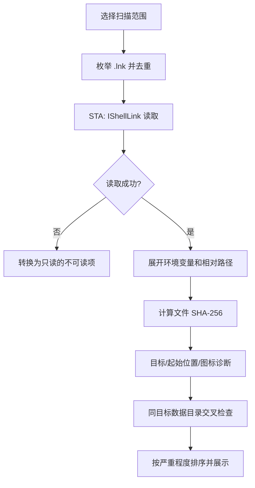
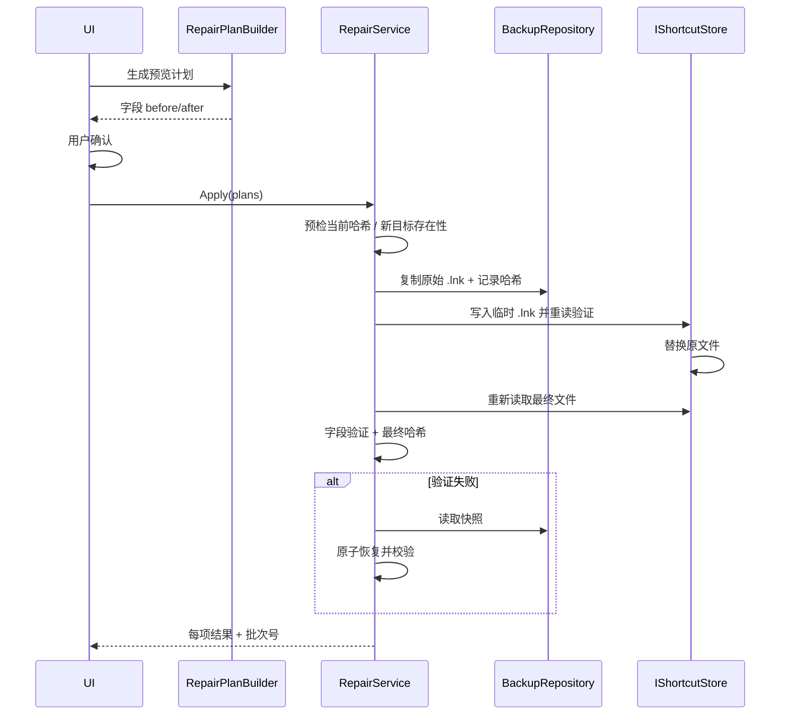

# LinkMend 架构与安全设计

## 1. 目标

LinkMend 要解决的核心问题不是“批量改 `.lnk`”，而是：

1. **准确判断哪里坏了**，并区分“永久失效”和“当前不可访问”；
2. **只在证据充分时修改**，不猜测候选程序；
3. **出问题时能恢复**：写入前备份、写入后验证、撤销前检查冲突。

因此核心层是大端可测试的规则引擎，Windows 相关能力集中在单独程序集，UI 只负责编排与呈现。

## 2. 分层

```text
LinkMend.App (net10.0-windows, WPF)
   ViewModels / Windows / Dialogs / Settings / Logging
        │
        ├──────────────┐
        ▼              ▼
LinkMend.Windows   LinkMend.Core
 (net10.0-windows)   (net10.0)
 ShellLink COM       models / contracts
 probes              diagnosis
 registry            relocation scoring
 bounded search      backup / repair / undo
 STA executor        scan orchestration
```

### LinkMend.Core

不依赖 WPF 和 Windows API；使用接口与系统交互：

| 接口 | 作用 |
| --- | --- |
| `IShortcutStore` | 读取/修改 `.lnk`，返回可解释的失败原因 |
| `ISystemProbe` | 路径状态、文件元数据、图标提取、固定磁盘根 |
| `IInstallationIndex` | App Paths / 卸载记录候选 |
| `IExecutableSearch` | 有界目录搜索 |
| `ISearchRootProvider` | 默认搜索根 |

主要服务：

- `ShortcutScanner`：枚举 `.lnk`，逐个读取、计算哈希、诊断，并把同目标的快捷方式列表交给数据目录规则做交叉判断。
- `ShortcutDiagnoser`：输出 `ShortcutIssue[]`，每条问题包含代码、严重程度、判断依据、处理方式（手动/自动/需定位）。
- `RelocationService`：收集安装提示与目录搜索结果，打分排序，从不由服务自动应用。
- `RepairPlanBuilder`：只把可解释、可安全调整的字段写入 `RepairPlan`。
- `RepairService`：预检 → 备份 → 写入 → 重读验证 → 必要时回滚。
- `UndoService`：预检所有文件哈希 → 创建撤销批次快照 → 逐项恢复 → 验证。
- `BackupRepository`：批次目录、历史 JSON、快照、路径校验。

### LinkMend.Windows

- `ShellLinkInterop`：`IShellLinkW` + `IPersistFile` 的 COM 声明。
- `WindowsShortcutStore`：
  - 读取目标、参数、起始位置、图标路径与索引；
  - 修改时先 `Load` 原文件，设置字段，`Save` 到同目录临时 `.lnk`；
  - 重读临时文件验证，再替换原文件；
  - 原文件不会在临时文件验证通过前被覆盖。
- `WindowsSystemProbe`：`GetFileAttributesW`、`ExtractIconExW`、`DriveInfo`；只读，不启动目标。
- `WindowsInstallationIndex`：App Paths 与卸载记录的候选提示。
- `WindowsExecutableSearch`：深度、目录数、结果数有上限，不跟随 reparse point，跳过系统/缓存目录。
- `StaExecutor`：每次扫描/修复在独立的 STA 线程上完成同步 COM 调用；COM 对象从不跨 `await` 使用。

## 3. 扫描与诊断流程



诊断不会自动修复，也不启动程序。需要外部输入的问题会明确归类为：

- `AutoFix`：图标/起始位置等可在本地安全调整的问题；
- `NeedsRelocation`：目标丢失，必须由用户选择候选；
- `Manual`：数据目录冲突、磁盘离线、权限不足、损坏等，不做自动修改；
- `None`：特殊/系统托管项。

## 4. 修复事务



关键不变量：

- `RepairPlan.ExpectedHash` 来自扫描；实际文件哈希不同则跳过。
- 每个批次的所有原始文件先进入备份，再进行写入。
- 写入的临时文件在替换前必须能被重新读取，且请求字段与读回值一致。
- 任何写入后验证失败都会尝试自动恢复；恢复结果会被记录，UI 不会把失败项显示成成功。
- 每个结果落盘后再次保存历史，进程中断时仍能查看已完成与未完成项。

## 5. 撤销事务

1. 检查修复批次是否存在成功的条目；
2. 检查是否已有真正恢复过文件的撤销批次；
3. 对每个成功条目重新计算当前哈希，与 `ResultHash` 比较；
4. 任一冲突 → **整次撤销不执行**，列出冲突；
5. 无冲突 → 为当前（修复后）文件建立撤销批次快照；
6. 从原始快照恢复到快捷方式，重新校验；
7. 每项写入撤销历史，原修复批次通过关系被推导为“已撤销”。

撤销不会重新创建被用户删除的文件，也不会覆盖修复后又被修改的文件。

## 6. 数据格式

默认根目录：`%LOCALAPPDATA%\LinkMend`。

```text
Backups/
  20261022-121500-1A2B/
    item-001.bak        # 原始 .lnk 字节
History/
  20261022-121500-1A2B.json
settings.json
linkmend.log
```

历史条目包含：

- `operation`: `repair` / `undo`
- `undoesBatchId`: 撤销批次引用的原批次
- `originalHash`: 写入前文件的 SHA-256
- `resultHash`: 成功修复/恢复后的 SHA-256
- `before*` / `after*`: 目标、起始位置、图标字段
- `status`: `pending` / `repaired` / `restored` / `failed`
- `message`: 可读结果或失败原因

批次号只允许 ASCII 字母数字和短横线；快照名必须是不含目录的文件名，避免从历史 JSON 构造路径穿越。

## 7. 测试策略

- Core 规则使用内存假体，覆盖边界条件，不依赖真实注册表或磁盘布局。
- 备份/修复/撤销测试在系统临时目录中创建真实文件，验证字节级恢复和哈希冲突。
- Windows 集成测试用 `WScript.Shell` 独立创建 `.lnk`，再通过本项目的 `IShellLink` 实现读取/修改/清除图标，验证互操作和字段保留。
- 测试集在 Windows CI 上运行；测试程序启动 COM 操作时使用 STA 线程。

## 8. 有意的取舍

- **原生 WPF 自绘样式**：避免 WPF UI 依赖，保持单文件发布和减少供应链面；以后可抽离主题层。
- **不使用 Shell 自动修复**：不调用“疑难解答”或 `ie4uinit` 强制刷新图标缓存，避免系统级副作用。
- **不用应用名猜配置路径**：数据目录只依赖显式参数，宁可少报，不制造“修复”。
- **不做后台常驻**：只在用户启动并操作时读取；没有遥测和网络请求。
- **有限搜索优先于全盘搜索**：先安装记录、用户目录和常见安装根；用户可添加目标目录后重搜。搜索的可解释性和响应性优先。
